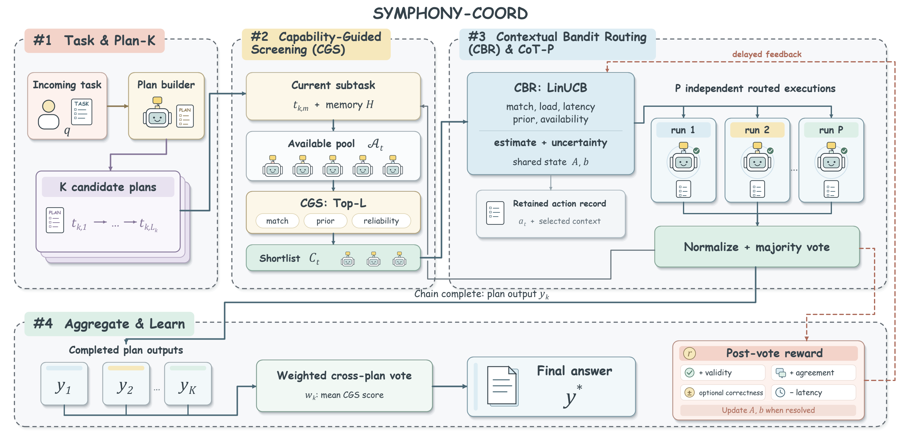

<h1 align="center">
Symphony-Coord
</h1>

<h3 align="center">
Adaptive Routing for Multi-Agent LLM Systems
</h3>

<p align="center">
Agents That Learn Who Should Solve What
</p>

<p align="center">
  <a href="https://arxiv.org/abs/2602.00966">
    
  </a>
  
  
</p>

<p align="center">
  <a href="https://arxiv.org/abs/2602.00966">📄 Paper</a>
  ·
  <a href="https://symphonycoord.ai">🌐 Live Demo</a>
  ·
  <a href="https://github.com/GradientHQ">💡 Ecosystem</a>
</p>


---
## Contents

- [Overview](#overview)
- [Citation](#citation)

---

<p align="center">
  <a href="assets/overview.pdf">
    
  </a>
</p>

<p align="center">
Task & Plan-K → Capability-Guided Screening (CGS) → Contextual Bandit Routing (CBR) & CoT-P → Aggregate & Learn
</p>

---
# Overview

Symphony-Coord is a task-local routing framework for multi-agent LLM systems. It formulates subtask-level executor selection as an online contextual bandit problem, using task information and observable service state.

Instead of relying on static expert assignment or handcrafted orchestration policies, Symphony continuously learns routing decisions from interaction outcomes.

The framework has four components, as shown above:

1. **Task & Plan-K:** form candidate plans and ordered subtask chains.
2. **Capability-Guided Screening (CGS):** retain a Top-L shortlist using capability match, prior success, and reliability.
3. **Contextual Bandit Routing (CBR) & CoT-P:** select executors with LinUCB and collect repeated subtask outputs.
4. **Aggregate & Learn:** combine outputs by subtask-level majority voting and weighted cross-plan voting, then update the selector when action-linked feedback is resolved.

Core mechanisms include:

- capability-guided, non-executing Top-L screening
- LinUCB routing using task and service context
- repeated subtask execution with majority voting
- weighted aggregation across candidate plans
- action-linked records for delayed post-vote feedback

Through continual feedback, routing policies evolve online and improve coordination quality over time.

---

# Citation

```bibtex
@misc{guan2026symphonycoordadaptiveroutingmultiagent,
      title={Symphony-Coord: Adaptive Routing for Multi-Agent LLM Systems}, 
      author={Zhaoyang Guan and Huixi Cao and Ming Zhong and Yin Wang and Guanyu Liu and Eric Yang and Lynn Ai and Yongxin Ni and Bill Shi},
      year={2026},
      eprint={2602.00966},
      archivePrefix={arXiv},
      primaryClass={cs.MA},
      url={https://arxiv.org/abs/2602.00966}, 
}
```

---

# Acknowledgements

We thank the open-source research community for foundational work in:

* decentralized systems
* online bandit optimization
* multi-agent reasoning
* Chain-of-Thought coordination
* distributed inference systems

---

# License

MIT License
